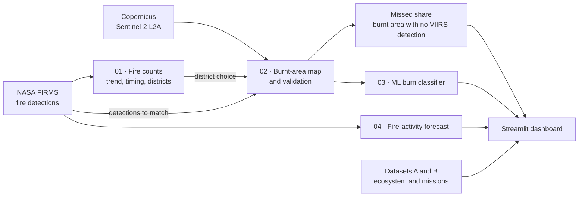

# India Space Mission Intelligence

### Paddy burnt-area monitoring with open satellite data


A decision-support prototype that maps paddy-residue burnt area in Punjab from Sentinel-2 imagery. It also measures how much of that burning the VIIRS fire counts, which official monitoring relies on, never see. The project is built to the *Satellite Mission Intelligence for India* deep-tech portfolio brief. That brief covers the Indian space ecosystem, a sourced satellite mission dataset, a reproducible geospatial analysis, mission trade-offs and a product concept.

> **Core question:** in a high-burning Punjab district, what share of the burnt area visible in Sentinel-2 imagery during the 2025 season was never flagged by a VIIRS fire detection?

## At a glance

| | |
|---|---|
| **Users** | Lead: buyers of paddy straw for energy, such as the compressed-biogas plant at Lehragaga in Sangrur, deciding where and when to collect straw. Second dashboard tab: the state agriculture department, deciding where to send residue-management machinery and where burning went undetected. |
| **Area and period** | Sangrur district, Punjab (pre-2021 boundary, including Malerkotla). Main season: 15 Sep–30 Nov 2025. Comparison: 2021. The 2026 season serves as a live demo. |
| **Satellite data** | Sentinel-2 L2A (Copernicus), VIIRS and MODIS active fires (NASA FIRMS). Sentinel-1, HLS and Resourcesat are compared in the mission trade-off. |
| **Methods** | Multi-date burn indices (NBR, MIRBI, NDVI), accuracy assessment against reference points, a Random Forest classifier, and a fire-activity forecast (SARIMA vs a seasonal baseline) |
| **Outputs** | Burnt-area maps, the share of burning the fire counts missed, a Streamlit dashboard, an 8–12 page report and a product one-pager |

## Why this matters

- Official stubble-burning monitoring counts fires seen by MODIS and VIIRS in a narrow midday window.
- A December 2025 report by iFOREST says most large Punjab farm fires in 2024 and 2025 occurred after 3 pm ([as reported by The Tribune](https://www.tribuneindia.com/news/delhi/satellites-miss-majority-of-stubble-fires-delhi-air-pollution-underestimated-report)).
- NOAA ends Suomi NPP data delivery at 13:00 UTC on 2 Nov 2026 ([NOAA update, 19 Oct 2026](https://www.nesdis.noaa.gov/news/administrative-update-2-cessation-of-suomi-national-polar-orbiting-partnership-s-npp-data-users-november-02-2026-1300-utc-and-decommissioning-issued-october-19-2026-1400-utc)).
- The two VIIRS satellites that remain pass about 25 minutes before and after Suomi NPP ([CIRA, May 2024](https://rammb2.cira.colostate.edu/visit-blog/2024/05/03/noaa-21-designated-as-the-primary-satellite-of-the-jpss-constellation)). So no VIIRS sensor looks later in the afternoon.
- Burnt area measured from Sentinel-2 is an established method ([NRSC, 2023](https://www.nrsc.gov.in/sites/default/files/ScienceStory/Science_Story_Stubble_burning_Pun_Har_2023.pdf)). This project applies it at district level and quantifies what fire counts miss.

## How the pieces fit



## Deliverables

| # | Deliverable | Where | Status |
|---|---|---|---|
| 1 | Research datasets: Indian space ecosystem (A, 32 companies) and satellite missions (B, 22 satellites) | `data/raw/research/` | Both drafted. B spot-checked (25 Oct) and corrected (26 Oct; see `sources/verification_log.md`); A's spot-check under way |
| 2 | Python notebooks | `notebooks/` | 01 complete (22 Oct 2026; study district chosen, see `decision_log.md`); 02 built and tested on synthetic data, ready for its pilot run; 03–04 planned |
| 3 | Geospatial analysis: QGIS project and export-ready maps | `maps/` | Planned |
| 4 | Interactive dashboard (Streamlit) | `dashboard/` | Planned |
| 5 | GitHub repository | this repo | Set up |
| 6 | Technical and product report, 8–12 pages | `report/` | Planned |
| 7 | Product one-pager | `report/` | Planned |
| 8 | Three-minute demo | `report/` | Planned |

## Repository structure

```
India-Space-Mission-Intelligence/
├── README.md
├── decision_log.md          dated decisions and the reasons for them
├── requirements.txt
├── data/
│   ├── raw/                 downloads, never edited; only research/ is committed
│   │   └── research/        hand-compiled datasets A (ecosystem) and B (missions)
│   └── processed/           outputs written by notebooks and scripts
├── notebooks/               01 fire counts · 02 burnt area · 03 ML classifier · 04 forecast
├── src/                     shared helper code, once notebooks stabilise
├── dashboard/               Streamlit app
├── maps/                    export-ready maps and the QGIS project
├── methodology/             problem statement and method notes
├── sources/                 source register, references and verification log
└── report/                  report, one-pager, demo script
```

## Quick start

No GPU is needed. Every step runs on an ordinary laptop CPU, and the Sentinel-2 processing runs on Copernicus servers through openEO. Outputs go to `data/processed/` and `maps/`, and every dataset used is logged in `sources/source_register.csv`.

### On your computer (VS Code)

You need Git, VS Code with the Python and Jupyter extensions, and either conda or Python 3.11/3.12.

1. **Get the code.** In VS Code, press Ctrl+Shift+P, run **Git: Clone**, paste `https://github.com/Panther2010/India-Space-Mission-Intelligence.git` and choose a folder. From a terminal, the same thing is `git clone https://github.com/Panther2010/India-Space-Mission-Intelligence.git`.
2. **Install the libraries** into an environment of their own, from the project folder.

   With conda (easiest on Windows; use the Anaconda Prompt):
   ```
   conda create -n eo -c conda-forge python=3.12 geopandas rioxarray -y
   conda activate eo
   pip install -r requirements.txt
   ```
   Or with Python's built-in venv:
   ```
   python -m venv .venv
   .venv\Scripts\python -m pip install -r requirements.txt     # Windows
   .venv/bin/python -m pip install -r requirements.txt         # macOS or Linux
   ```
3. **Add your key.** Get a free [FIRMS map key](https://firms.modaps.eosdis.nasa.gov/api/map_key/). In VS Code, create a file named `.env` in the project folder, next to this README, with one line: `FIRMS_MAP_KEY=your_key`. Git ignores `.env`, so the key never reaches GitHub.
4. **Run.** Open `notebooks/01_fire_counts.ipynb`, choose the `eo` (or `.venv`) kernel at the top right and click **Run All**.
5. **For Notebook 02,** create a free [Copernicus Data Space Ecosystem](https://dataspace.copernicus.eu/) account. The first run prints a login link for openEO; later runs reuse the saved login. Notebook 02 runs in steps (a small pilot first, then the whole district), explained at its top.

### In Google Colab

1. Copy this repository to Google Drive as `MyDrive/India-Space-Mission-Intelligence`.
2. Open `notebooks/01_fire_counts.ipynb` in Google Colab.
3. Add the FIRMS map key as a Colab secret named `FIRMS_MAP_KEY` (key icon in the left sidebar).
4. Choose **Runtime → Run all**.

## Data and licences

| Data | Provider | Terms |
|---|---|---|
| VIIRS and MODIS active fire detections | [NASA FIRMS](https://www.earthdata.nasa.gov/faq/firms-faq) | NASA open data policy; cite per the FIRMS citation policy |
| Sentinel-2 L2A imagery | [Copernicus Data Space Ecosystem](https://dataspace.copernicus.eu/) | Free and open; credit "Contains modified Copernicus Sentinel data [year]" ([licence](https://ads.atmosphere.copernicus.eu/licences/ec-sentinel)) |
| District boundaries | [geoBoundaries via HDX](https://data.humdata.org/m/dataset/geoboundaries-admin-boundaries-for-india) | ODbL |
| State boundaries | [geoBoundaries](https://www.geoboundaries.org/) ADM1, from the DataMeet India community and the Election Commission of India ([source](https://github.com/datameet/maps)) | Creative Commons Attribution 2.5 India (CC BY 2.5 IN); credit the source |

Access dates and preprocessing steps are in `sources/source_register.csv`, and context sources are in `sources/references.md`. Raw downloads are not committed, because of their size and their licence terms.

## Evidence rules

These come from the project brief:
- Every factual record carries a source URL and an access date.
- Reported facts, our calculations and our recommendations are labelled separately.
- Missing values stay blank or are marked "not found". They are never guessed.
- Raw data is never edited; scripts produce the processed outputs.
- Coordinate systems, units, dates, nulls and duplicates are checked.

## Known limitations

- A fire detection is a 375 m pixel that contained fire at the moment the satellite passed. It is not a field, and counts are not burnt area.
- Optical imagery misses burns under cloud or smoke, and burn scars can vanish once fields are tilled.
- Reference labels come from interpreting imagery, not from field visits.
- Health impacts are context only; this project does not measure them.

## Timeline

| Week | Dates (2026) | Focus |
|---|---|---|
| 1 | 22–28 Oct | Set-up, fire counts, district choice, datasets A and B, problem statement |
| 2 | 29 Oct–4 Nov | Sentinel-2 burnt-area mapping, validation, maps, mission trade-off |
| 3 | 5–11 Nov | ML classifier, forecast, 2021 comparison, dashboard v1 (light days 7–9 Nov for Diwali) |
| 4 | 12–18 Nov | Product concept, report, one-pager, demo |

## Author

**Mohit Sharma** ([@Panther2010](https://github.com/Panther2010)). The code licence will be added before the first release. Data keep their original licences.
