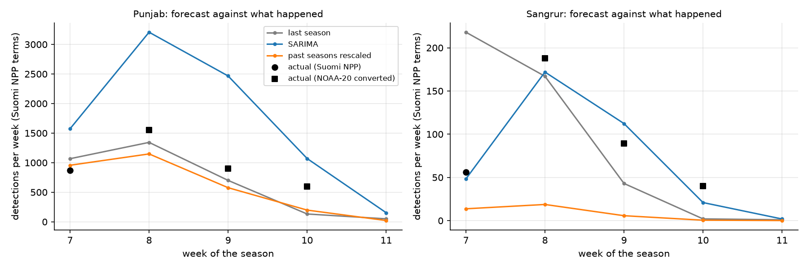
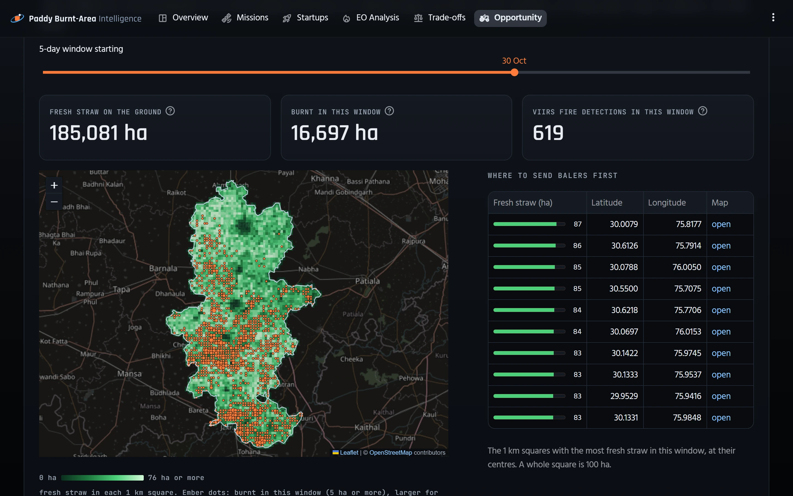

# Paddy burnt-area intelligence for Punjab

**What fire counts miss, and a five-day straw map for buyers of paddy straw**

Technical and product report for the *Satellite Mission Intelligence for India* portfolio brief · Mohit Sharma · 19 November 2026

Live dashboard: <https://india-space-mission-intelligence-dashboard.streamlit.app> · Code and data: <https://github.com/Panther2010/India-Space-Mission-Intelligence>

> **Status: interim.** Everything here is final except the 2026 forecast (section 6.5), which is scored to 16 Nov 2026 and will be finalised after 30 Nov 2026.

**Labels.** Every statement carries one. **[Reported]** comes from a cited source. **[Ours]** was measured in this project, for Sangrur district on its pre-2021 boundary unless stated. **[Recommendation]** is our judgement.

## 1. Summary

**The question.** In Sangrur, the Punjab district with the most satellite fire detections over 2021–2025, how much paddy straw burned in the 2025 harvest? How much of that burning did the fire counts miss? And could a satellite map help a straw buyer reach straw before it is burnt?

<!-- tiles -->
| 63,400 ha | 90.6% | −47% | 10 days |
|---|---|---|---|
| burnt in 2025, 20.7% of the area harvested [Ours] | of that burnt area had no VIIRS fire detection within 375 m [Ours] | burnt area, 2021 to 2025, while fire detections fell 95% [Ours] | median time from harvest to burning [Ours] |

**What we found.**
- **About a fifth of the harvest burned.** Sentinel-2 mapped 63,400 ha burnt out of 306,500 ha harvested. Checked against 187 labelled points, the map scores F1 0.92 [Ours].
- **The fire counts missed nine-tenths of it.** For 90.6% of the burnt area, no VIIRS detection fell within 375 m around the time of the burn. The loosest rule tried still leaves 60.4% unseen [Ours].
- **Fire counts overstate the fall in burning.** From 2021 to 2025 the burnt area halved (−47%) on an almost unchanged harvest, while Suomi NPP fire detections fell 95% [Ours]. Fire counts can no longer show whether burning is falling.
- **A buyer has about ten days.** Fields that burned did so a median of 10 days after harvest, and 85% of the burnt area was first seen in the fortnight from 30 Oct [Ours].

**What we propose** [Recommendation]. A straw map for the procurement teams of biogas plants that run on paddy straw. Every five days it shows which 1 km squares hold freshly harvested fields not yet burnt, and where burning has started. The same pipeline gives the district agriculture department a direct measure of burnt area. It runs on free Sentinel-2 data and a laptop. The next experiment is a pilot with one buyer, measuring the tonnes of straw collected from squares the map flagged before they burned.

**The main limits.** Labels come from imagery, not field visits, and 53 of the 240 reference points stayed doubtful. Counting them both ways, the burnt area estimated from the labels runs from 52,700 to 141,200 ha. The analysis covers one district in two seasons, and the product has not been tested with buyers (section 8).

## 2. Problem and user

| Element | |
|---|---|
| **Lead user** | The biomass procurement manager of a compressed-biogas plant that runs on paddy straw. Verbio's plant at Lehragaga, in Sangrur, uses 100,000 t of agricultural residue a year, by the company's account [Reported: Verbio, 2022]. |
| **Second user** | The district agriculture officer [Recommendation, adopted 25 Oct 2026]. |
| **Decision to improve** | *Buyer:* where and when to send balers and collection teams before straw is burnt. *Department:* where to target residue-management machinery and outreach, and whether burning is really falling. |
| **Pain point** | Fire counts come from satellites passing in the early afternoon and at night [Ours], while most large Punjab farm fires in 2024 and 2025 burned after 3 pm [Reported: iFOREST, via The Tribune, 2025]. Counts show fire at the moment of a pass. They show neither how much area burned nor which harvested fields still hold straw. |
| **Data needed** | A Sentinel-2 time series for harvest and burn status; VIIRS and MODIS fire detections from NASA FIRMS; district boundaries; reference labels. |
| **Expected output** | A 20 m map of burnt area with the date each burn was first seen; harvested but unburnt area on a 1 km grid every five days; the share of burnt area the fire counts missed. |
| **Success metric** | *Prototype:* precision and recall each at least 0.80 at reference points [Recommendation]. The map reached 0.87 and 0.97 [Ours]. *Product:* tonnes of straw collected, in a pilot, from areas the map flagged before they burned [Recommendation]. |

**Why Sangrur.** Over 2021–2025 it had the most Suomi NPP fire detections of any district in Punjab and Haryana: 21,766, or 11.4% of the two states' total. It had the second most in 2025 [Ours, Notebook 01]. It is mapped on its pre-2021 boundary, which includes Malerkotla, made a separate district on 2 June 2021 [Reported: Malerkotla district website].

**Why it matters commercially.** Straw already leaves Punjab's fields in large amounts. In its status report to the National Green Tribunal of 26 Nov 2024, the state puts paddy-straw generation at about 19.7 million tonnes. It says more than 6.2 million tonnes were managed ex situ, that is, collected for use off the field, "during the current year" [Reported: State of Punjab, 2024]. Every tonne a buyer reaches before it is burnt is feedstock gained and smoke avoided [Recommendation].

## 3. The Indian space ecosystem: who could build, supply or buy this

Dataset A maps 32 Indian space companies across the brief's seven value-chain categories, each with its evidence page and the date it was read. Every row's city, product and customer was spot-checked against its source on 18–19 Nov 2026 [Reported; checks in `sources/verification_log.md`].

- **The sector's shape** [Ours, counted from dataset A]: Satellites 8, Space Data/Analytics 6, Launch 5, Propulsion 4, Components 4, Earth Observation 3, Ground Systems 2. Bengaluru is home to 13 of the 32 companies. Karnataka has 14, and Telangana comes next with 6.
- **Where this product sits.** Downstream, in Space Data/Analytics. It needs no satellite of its own, because Sentinel-2 data are free and open [Recommendation].
- **Nine companies work in Earth observation or space data, the segment closest to this product** [Reported, mostly company statements]:
  - *Already selling agricultural analytics* to agribusiness, lenders, insurers or government: SatSure, Satyukt Analytics and Cropin. They could be partners, sales channels or competitors.
  - *Imagery for the smoke weeks:* GalaxEye's Drishti satellite combines optical and radar sensors for imaging in any weather; it launched on 3 May 2026. Suhora's SPADE platform brings together radar, optical and thermal data. Either could cover the late-October gap that optical data leave (section 7).
  - *The closest earlier product:* Blue Sky Analytics' Zuri turned NASA and ESA satellite data into stubble-burning information: fire counts, intensity and predictions (The Quint, 2019). The company's later material, which is undated, describes climate data for carbon markets and climate risk and doesn't mention Zuri. Whether Zuri still runs is not confirmed.
- **The gap** [Ours]: none of the 32 companies' sources describes a map, for buyers, of harvested fields not yet burnt, refreshed through the harvest. Zuri worked from fire data, which in Sangrur missed most of the burning (section 6.2).

## 4. Data

| Data | Provider | Detail | Used for |
|---|---|---|---|
| Sentinel-2 L2A (2A, 2B, 2C) | Copernicus Data Space Ecosystem, through openEO | Red, near-infrared (NIR) and both short-wave infrared (SWIR) bands at 20 m; 5-day composites, 5 Sep–4 Dec, 2025 and 2021 | Harvest and burn mapping |
| VIIRS 375 m active fires (Suomi NPP, NOAA-20, NOAA-21); MODIS 1 km | NASA FIRMS | Detections from early-afternoon and night passes | Missed share; trends, 2012–2025; the 2026 forecast |
| Landsat 8 and 9 (HLS L30 v2.0) | NASA LP DAAC, through Earthdata | 30 m | Settling doubtful reference points |
| District and state boundaries | geoBoundaries | Sangrur on its pre-2021 boundary | Study area |
| Dataset A: Indian space ecosystem | Compiled for this project | 32 companies; source and date for each row | Section 3 |
| Dataset B: satellite missions | Compiled for this project | 22 satellites; source and date for each row | Sections 4 and 7 |

- **Why Sentinel-2** [Reported, dataset B]: it is the finest free imagery with both SWIR bands (about 1.6 and 2.2 µm), which separate burnt fields from bare soil, at 10–20 m. In 2025 three Sentinel-2 satellites imaged each point every 2–3 days [Ours].
- **Why VIIRS:** its detections are the fire counts this project tests. Each flags a 375 m pixel holding fire while a satellite passed, not a burn scar [Reported: Schroeder et al. 2014].
- **Every source is registered.** `sources/source_register.csv` lists the 20 data sources with provider, link, access date, licence, preprocessing and known limits, and `sources/references.md` lists the context sources [Ours]. Raw downloads stay out of the repository because of their size and licence terms; the processed outputs are committed.
- **Licences.** Copernicus Sentinel data are free and open, with a credit line. NASA data are open under NASA's data policy. Boundaries are under ODbL and CC BY 2.5 India [Reported].

## 5. Method

The analysis runs as notebooks on an ordinary laptop CPU, with Sentinel-2 processed on Copernicus's servers through openEO [Ours]. `report/findings_numbers.py` reprints every number in section 6 from the committed outputs.

1. **Fire counts (Notebook 01).** VIIRS detections for 2012–2025 from the FIRMS API are cleaned of duplicates and non-vegetation fires, then counted by season, district and time of day. This notebook chose the district.
2. **Burnt-area map (Notebook 02).** It uses Sentinel-2 L2A red, NIR and SWIR bands at 20 m, keeps clear pixels by the scene classification, and makes median composites for eighteen 5-day windows from 5 Sep to 4 Dec 2025. Each pixel is followed through the windows:
   - *green* once NDVI reaches 0.6, then *harvested* when NDVI falls below 0.35;
   - *burnt* in a harvested window when NBR ≤ −0.05, MIRBI ≥ 1.65 and NIR reflectance ≤ 0.13.

   The NIR test was added after the pilot. Bare soil passes the two index tests too, but it is brighter in NIR than fresh char: without the test the pilot called 91% of harvested land burnt, with it 25% [Ours]. Burns first seen from 19 Nov are left out of the headline as unconfirmed, because damp soil under a young crop can pass the same tests [Ours]. The whole-district job used 8 openEO credits and took 11 minutes [Ours].
3. **Validation (Notebook 02).** 240 points were drawn at random by mapped class: 100 burnt, 100 harvested but not burnt, and 40 elsewhere. Each sits at the centre of a uniform 3 × 3 block and was labelled blind from single-date 10 m Sentinel-2 images. Every point was read twice, by the author and independently by an AI assistant (Claude). Doubtful points stayed `unsure`, and Landsat views (Notebook 02b) settled 3 of them. Accuracy is area-weighted (Stehman 2014), and the burnt area is also estimated from the labels alone, with a 95% confidence interval (Olofsson et al. 2014). The doubtful points are reported both ways [Ours].
4. **Missed share (Notebook 02).** This is the share of confirmed burnt area with no fire detection nearby between the pixel's last clear view and its burn. It is measured under three rules: VIIRS within 375 m; VIIRS within 750 m; and VIIRS within 750 m or MODIS within 1 km [Ours].
5. **2021 against 2025 (Notebook 02c).** The same rule, thresholds, windows and district were run on 2021. The missed share is recomputed from the two VIIRS satellites flying in both seasons [Ours].
6. **Machine learning (Notebook 03).** A Random Forest of 500 trees (Breiman 2001) learns burnt or not from 23 seasonal features at the 147 labelled points on harvested land. It is scored by 5-fold cross-validation repeated 10 times and compared with the rule by McNemar's test. Six other classifiers were run the same way [Ours].
7. **Forecast (Notebook 04).** Weekly Suomi NPP detections for 2012–2025 feed three methods that forecast the rest of the 2026 season: last season, a seasonal ARIMA (SARIMA), and past seasons rescaled to 2026's early weeks. Each was backtested on 2016–2025 from the same week. Past seasons rescaled had the smallest error over 2021–2025 and became the headline. The forecast was issued and committed on 1 Nov 2026, before the outcome, and is checked each week [Ours]. Suomi NPP data stopped at 13:00 UTC on 2 Nov 2026 [Reported: NOAA NESDIS, 2026]. So from week 8 the actual counts are NOAA-20's, converted by the two sensors' 2026 ratio of 0.89 [Ours].

## 6. Findings

### 6.1 How much burned in 2025

- **63,400 ha burnt out of 306,500 ha harvested: 20.7%** (Figure 1, left) [Ours]. Another 8,200 ha first looked burnt from 19 Nov and are left out as unconfirmed [Ours].
- **The map holds up at the labelled points.** It scores precision 0.87, recall 0.97 and F1 0.92 at 187 points, with an area-weighted overall accuracy of 0.96 (standard error 0.015) [Ours].
- **The labels alone agree.** They put the burnt area at 68,300 ha (95% CI 57,400–79,200 ha), and the map's 63,400 ha lies inside that interval [Ours].
- **The doubtful points are the largest uncertainty.** 53 of the 240 points stayed `unsure`. Counted all as not burnt, then all as burnt, they give F1 0.82 and 0.78, and a burnt area of 52,700–141,200 ha [Ours]. The high end comes from 31 `unsure` points in fields mapped as harvested but not burnt, each standing for about 2,300 ha.
- **Machine learning adds nothing here.** The Random Forest tied the rule (F1 0.92), and six other classifiers scored 0.89–0.94. None beat the rule beyond chance: McNemar p was never below 0.14, in any run of any model. The forest's F1 levels off at about 0.92 from 40 training points. It relies on how dark the field turned after harvest, the same signal the rule tests [Ours]. So the rule stays. It needs no labels, is easier to explain, and carries to another season unchanged [Recommendation].

### 6.2 What the fire counts missed

- **Nine-tenths of the burnt area had no detection nearby.** For 90.6% of the confirmed burnt area, no VIIRS detection fell within 375 m between the field's last clear view and its burn. Allowing 750 m leaves 73.8% unseen, and adding MODIS within 1 km still leaves 60.4% (Figure 1, right) [Ours].
- **The peak went largely unseen.** 1,143 of the season's 1,500 VIIRS detections came in the three busiest windows, from 30 Oct to 13 Nov. Yet they flagged only 12%, 11% and 7% of the burnt area first seen in each [Ours].
- **The satellites look at the wrong time of day.** Every daytime VIIRS detection in the district in 2025 came between 12:28 and 14:39 IST, and only 20 of the 1,500 (1.3%) came at night [Ours]. iFOREST reports that most large Punjab farm fires in 2024–25 burned after 3 pm [Reported]. The VIIRS satellites left after Suomi NPP pass about 25 minutes before and after it, so none looks later in the afternoon [Reported: CIRA, 2024].
- **What fits the gap** [Recommendation]: a fire lit after the afternoon passes and out before the night pass is never counted. That fits the missed share, but these data have no burn times, so they cannot show it.

### 6.3 Timing: the buyer's window

- **Burning follows harvest by about ten days.** Half the season's harvest was first seen by the window starting 25 Oct. Fields that burned did so a median of 10 days after harvest, in 2021 and 2025 alike [Ours].
- **Most burning falls in one fortnight.** Half the burnt area was first seen by the window starting 4 Nov, which was the busiest (24,000 ha, 38% of the season). 85% fell in the three windows from 30 Oct to 13 Nov [Ours].
- **At the peak, a large stock of straw was still on the ground.** In the window starting 30 Oct, about 185,000 ha had been harvested in the previous ten days and not yet seen burnt (Figure 4) [Ours]. Some of that straw will already have been baled or ploughed in, which the map cannot see.
- **Sentinel-2 saw almost everything.** From 15 Oct it saw at least 99.9% of the district clearly in every 5-day window but one: 25–29 Oct, when 71% was clear [Ours].
- **For the buyer** [Recommendation]: about ten days between harvest and burning, and most burning within a fortnight. A map refreshed every five days catches that window, with little to spare.

<!-- pair 86 -->

*Figure 1. Left: burnt area in Sangrur in the 2025 season at 20 m, and whether a VIIRS detection fell within 375 m around the time of the burn. Right: burnt area with no VIIRS detection, as a share of each 1 km square, with the detections as dots. North is up. The full maps, with titles and method notes, are in `maps/qgis/` [Ours]. Contains modified Copernicus Sentinel data 2025; fire detections from NASA FIRMS.*

### 6.4 2021 against 2025: fire counts overstate the fall

- **The harvest held steady while burning halved.** The harvested area was 315,700 ha in 2021 and 306,500 ha in 2025 (−3%). The confirmed burnt area fell from 119,800 to 63,400 ha: −47%, or −49% counting late burns. On land harvested in both seasons, the burnt share fell from 39.6% to 21.1% [Ours].
- **Fire counts fell much further.** Suomi NPP detections inside the district fell 95%, from 9,078 to 483, and from 76 to 8 per 1,000 ha burnt. Across Punjab they fell by the same proportion, from 78,678 to 4,271 [Ours].
- **So the counts now miss most of the burning.** Measured with the two VIIRS satellites flying in both seasons, the missed share rose from 27% to 94% [Ours].
- **The same land keeps burning.** 56% of the area burnt in 2025 had burnt in 2021 too [Ours].
- **Where it fell.** Burning fell in 86% of the district's 1 km squares. It fell least in the southern quarter (−23% for confirmed burns, −39% counting late burns) and most in the northern quarter (−61% and −56%) [Ours].
- **Not an artefact of fewer looks.** Sentinel-2 had 15 dates over the pilot area in 2021 and 17 in 2025, and the 2021 windows from 25 Oct were clear [Ours]. Why the counts fell further is still open: later burning, smaller or shorter fires and partial burns all fit [Recommendation].

*Figure 2. Sangrur, 2025 as a percentage of 2021: harvested area 97, burnt area 53, Suomi NPP fire detections 5 [Ours, Notebook 02c].*

### 6.5 The 2026 forecast so far (interim, to 16 Nov)

- **The forecast, issued 1 Nov from data to 26 Oct** [Ours]:
  - *Punjab:* about 2,700 more Suomi NPP detections by 30 Nov (80% range 2,200–6,400), or about 3,500 for the season, against 4,269 in 2025.
  - *Sangrur:* about 44 more (range 23–65). It rested on only 3 detections, a weakness recorded the day it was issued.
  - *Busiest week:* most likely week 8 (3–9 Nov), for both.
- **Checked over weeks 7–9, 27 Oct to 16 Nov** [Ours]:
  - *Punjab:* 3,322 detections against 2,681 forecast, about a fifth too few. The last-season baseline came closest (3,110, 6% too few), and SARIMA forecast more than twice as many (7,246).
  - *Sangrur:* 333 against 38, about nine times too few. SARIMA came closest (332). The fragile forecast failed, as flagged when it was issued.
  - *The busiest week was right for both:* week 8.
- **The season so far** [Ours]. Punjab's 4,071 detections to 16 Nov already exceed the 1 Nov forecast for the whole season (about 3,500), but lie inside its 80% range of 2,954–7,143. The updated forecast of 18 Nov puts the season at 4,236, close to 2025's 4,269.
- **Caveat.** From week 8, the actual counts are NOAA-20's converted to Suomi NPP terms, which adds uncertainty [Ours]. The score is final after 30 Nov.

*Figure 3. Weekly detections forecast by the three methods against what happened, weeks 7–11 of the 2026 season. Weeks 10 and 11 are still to come [Ours, Notebook 04, run of 18 Nov 2026].*

### 6.6 What it adds up to

- **Fire counts do not measure how much burned.** Read from the counts alone, burning in Sangrur fell 95% from 2021 to 2025. The burnt-area map says it halved [Ours].
- **For the buyer** [Recommendation]: the harvest and burnt-area maps show where straw still lay and for how long. A five-day refresh fits the roughly ten days between harvest and burning.
- **For the department** [Recommendation]: fire counts can no longer show whether burning is falling. A burnt-area map measures it directly, a few days behind.
- **For forecasting** [Ours]: a forecast of fire counts forecasts what satellites see, not how much burns. The method that backtested best still missed Sangrur badly when its early counts were tiny.

## 7. Mission trade-off

**The requirement** [Recommendation]. The data must resolve single fields (30 m or finer, ideally 10–20 m) and give a clear view at least every 2–3 days from mid-October to late November. They need SWIR bands to tell char from tilled or damp soil, and a way through late-season cloud and smoke. They should be free for a prototype and checkable against reference points.

| Option | Detail | How often | Bands for burns | Cloud and smoke | Cost | Role |
|---|---|---|---|---|---|---|
| **Sentinel-2 MSI** | 10 m; SWIR at 20 m [R] | Every 5 days with two satellites [R]; every 2–3 days with three in 2025 [O] | Both SWIR bands [R] | Optical; 71% clear on 25–29 Oct [O] | Free [R] | **Core** |
| **HLS** (Landsat 8/9 matched to Sentinel-2) | 30 m [R] | Landsat every 8 days; every 2–3 days with Sentinel-2 [R] | Both SWIR bands [R] | Optical; most November views flagged for smoke [O] | Free [R] | **Extra dates**: settled 3 of 26 gap points [O] |
| **VIIRS active fires** | 375 m fire pixels [R] | Daily, early afternoon and night [R] | Thermal: fire at the pass, not a scar [R] | Misses fires between passes [R] | Free [R] | **Alerts and trends, never area**: missed 90.6% [O] |
| **Sentinel-1 SAR** | 5 × 20 m [R] | Every 6 days with two satellites [R] | Radar, no optical bands [R] | Sees through cloud and smoke [R] | Free [R] | **Next experiment** |
| **Resourcesat-2/2A AWiFS** (ISRO) | 56 m [R] | Every 2–3 days with both [R] | One SWIR band, no 2.2 µm, so the rule can't run as it is [O] | Optical | Free on Bhoonidhi [R] | **Indian backup, to test** |
| **PlanetScope** | About 3 m [R] | Near daily [R] | No SWIR [R] | Optical | Paid [R] | **Only for a paying customer** |

*[R] Reported, from dataset B; [O] Ours, measured in Sangrur in 2025.*

**Why this order** [Recommendation]:
- **Sentinel-2 is the core.** It has the finest free detail with both SWIR bands, and in 2025 it saw almost the whole district clearly in every 5-day window but one. Its weak spot is the burning peak. At 26 of the 240 points (11%), no clear view came for a week or more while the straw went, all between 23 Oct and 2 Nov [Ours]. Sentinel-2A's extended campaign is set to end on 31 Dec 2026 [Reported], so from 2027 a point may be seen only about every 5 days.
- **HLS adds Landsat dates** on the same grid at no cost, but it helped little in the smoke weeks.
- **VIIRS stays for same-day alerts and long trends.** It is no measure of area.
- **Sentinel-1 is the next experiment.** It is the only free option that sees through the late-October smoke. It probably cannot confirm a burn, but it may date when straw leaves a field, which is the buyer's question. Test it on the 23 gap points that are still undated.
- **AWiFS is a continuity test, not the core.** ISRO's sensor is free, wide and frequent, but its 56 m pixels blur fields and it lacks the 2.2 µm band. India's radar satellites repeat too slowly for a ten-day window: EOS-04 every 17 days in its medium mode, and NISAR every 12 days [Reported].
- **PlanetScope only for a paying customer.** Near-daily 3 m imagery would shrink the gaps, but without SWIR it cannot tell char from damp soil.

**Validation for each** [Recommendation]. Sentinel-2's is done, at 240 points. HLS is checked on the same points, and VIIRS through the missed share. Sentinel-1 would be checked at points where optical views date the change from straw to soil within 3 days, and AWiFS by running a NIR–SWIR index on the same points. PlanetScope would need a small paid sample, if a pilot justified it.

## 8. Limitations

| Limit | What it means | Which way it moves the findings |
|---|---|---|
| **Small and partial burns, and scars that fade** | A burn covering part of a 20 m pixel, or falling between two clear views, may never show. Scars looked like tilled soil within 2–3 days [Ours]. Straw burnt in small heaps (one farmer's account, from Maharashtra) and burning of loose straw only, before a super seeder (reported from Sangrur and Patiala, 2022), would leave such burns [Reported]. | 63,400 ha is a field-scale lower bound, and the fire counts probably miss more than 90.6% [Recommendation] |
| **Labels from imagery** | No field visits. Every point was read twice, the second time by an AI assistant. 53 of the 240 points stayed `unsure` [Ours]. | F1 0.78–0.92, and burnt area 52,700–141,200 ha, with the `unsure` points counted both ways [Ours] |
| **Points at block centres** | Accuracy at field edges and in small patches is untested. That is where the rule and the forest disagree: 91% of the pixels only the rule calls burnt lie on a patch edge [Ours]. | Unknown; errors at edges could go either way [Recommendation] |
| **Late burns unconfirmed** | From 19 Nov, damp soil under a young crop can pass the tests [Ours]. | If all 8,200 ha were real burns, 2025's burnt area would be 71,600 ha [Ours] |
| **"Nearby" is a choice** | A detection marks the centre of a 375 m pixel, not the fire's exact position [Reported]. | Missed share 60.4–90.6% across the rules tried; most burning went unseen under all of them [Ours] |
| **No crop map** | "Harvested" means land that greened and was then harvested in the season, not checked to be paddy [Ours]. | Other crops harvested in the same weeks could be included [Recommendation] |
| **The 2021 map has no labels** | Its accuracy is unknown. NOAA-20 moved in its orbit in April 2024, so pass spacing differed between the seasons [Reported]. | The fall in burning holds with or without late burns: −47% or −49%, against −95% for detections [Ours] |
| **The forecast is of detections** | Near-real-time counts are set against a standard-processing archive; ten backtests give only rough ranges; counts from week 8 are converted [Ours]. | Sangrur's forecast failed on 3 early detections [Ours] |
| **Scope** | One district and two seasons; optical data only; the product is untested with buyers; health effects are not measured [Ours]. | Wider claims need more districts and the pilot [Recommendation] |

## 9. Product concept: if I were building a space startup

| | |
|---|---|
| **Customer and unmet need** | The procurement team of a biogas plant that runs on paddy straw. It needs to know, week by week, where harvested straw is still lying unburnt, because a field that burns typically does so about ten days after harvest [Ours]. |
| **Current alternatives and the gap** | Fire counts show fires at a satellite pass, and missed 90.6% of Sangrur's burnt area in 2025 [Ours]. Zuri (2019) built stubble-burning information on fire data [Reported]. NRSC mapped the 2023 season's burnt area in Punjab and Haryana from Sentinel-2 [Reported: NRSC, 2023]. Agri-analytics firms sell crop monitoring, not straw logistics [Reported, dataset A]. The gap: a map, for buyers, of harvested fields not yet burnt, refreshed through the harvest [Ours]. |
| **Product and decision output** | Every five days: fresh straw in each 1 km square, burning first seen in the window, and a ranked list of squares to send balers to, with map links (Figure 4). For the department: burnt area and missed share by block, set against the fire counts [Recommendation]. |
| **Data needed** | *Satellite:* Sentinel-2 (core), HLS (extra dates), VIIRS (same-day alerts) and Sentinel-1 (to test). *Other:* the buyer's collection records (tonnes by village and date), baler routes, field visits for labels and block boundaries [Recommendation]. |
| **MVP scope** | One district, one buyer and one harvest (October–November 2027); 1 km squares; the dashboard and a downloadable list at each refresh; no farmer-level data [Recommendation]. |
| **Technical and regulatory dependencies** | Processing on Copernicus through openEO: the district job used 8 credits [Ours], within the 10,000 free credits a month for general users [Reported: CDSE]. The revisit drops when Sentinel-2A's extended campaign ends on 31 Dec 2026 [Reported]. India's geospatial guidelines of 15 Feb 2021 remove the need for prior approval to acquire or produce geospatial data, outside a negative list of sensitive attributes [Reported: DST, 2021]. A map of 1 km squares, not named farms, keeps personal data out; linking fields to farmers would likely bring in the Digital Personal Data Protection Act, 2023 [Recommendation]. |
| **Validation plan** | Field visits at a stratified sample during the season, field edges included; the lag between a square being flagged and the balers arriving; tonnes collected from flagged squares against unflagged ones [Recommendation]. |
| **Business model hypothesis** | A seasonal subscription per plant, priced below the value of the extra straw secured or the baler days saved, and a public version for the department under an annual contract. Both are untested: the pilot sets the price [Recommendation]. |
| **Key risks** | Buyers may not change routes on a five-day map. Cloud and smoke hide the peak. Sentinel-2 looks less often from 2027. "Not seen burnt" is not "still there": straw may already be baled or ploughed in. Farmers may see a map of burning as an enforcement tool [Recommendation]. |
| **Next experiment** | Sentinel-1 on the 23 undated gap points, then a pilot with one buyer in the 2027 harvest, measuring the tonnes collected from flagged squares before they burned [Recommendation]. |

*Figure 4. The buyer's map on the dashboard's Opportunity page, for the window starting 30 Oct 2025. Green: fresh straw in each 1 km square, harvested in the last ten days and not yet seen burnt. Ember dots: burning first seen in the window. Right: the squares to send balers to first [Ours].*

## 10. Next steps

1. **Score the 2026 forecast** after 30 Nov and finalise section 6.5, in early December 2026.
2. **Test Sentinel-1** on the 23 undated gap points: does the radar change fall in the window that optical views date to within 3 days? [Recommendation]
3. **Label field edges and small patches,** ideally from field visits in the 2027 harvest, since that is where the rule and the forest disagree [Recommendation].
4. **Run the buyer pilot** with one biogas plant in Sangrur in the 2027 harvest, measuring the tonnes collected from flagged squares [Recommendation].
5. **Then widen** to more districts, once the pilot shows that the map changes where balers go [Recommendation].

**Checking this report.** The notebooks run in order (01, 02, 02b, 02c, 03, 04) on a laptop, and their outputs are committed in `data/processed/`. `report/findings_numbers.py` reprints the numbers in section 6, and `decision_log.md` records every choice with its date and reason. The working drafts behind sections 6–8 are in `report/` (`findings.md`, `ml_classifier.md`, `mission_tradeoff.md`, `limitations.md`), with the full method in `methodology/methodology.md`.

## References

- Blue Sky Analytics (undated). *Blue Sky Analytics and Esper Satellites announce strategic imagery partnership for carbon monitoring infrastructure*. <https://blueskyhq.io/press-release/blue-sky-analytics-and-esper-satellite-imagery-announce-strategic-partnership-to-develop-monitoring-infrastructure-for-the-carbon-markets> (accessed 19 Nov 2026).
- Breiman, L. (2001). Random forests. *Machine Learning* 45, 5–32. <https://doi.org/10.1023/A:1010933404324>
- CDSE (2026). openEO credit usage. <https://documentation.dataspace.copernicus.eu/APIs/openEO/credit_usage.html> (accessed 25 Oct 2026).
- CDSE. Sentinel-2A extended campaign. <https://dataspace.copernicus.eu/node/3911> (accessed 26 Oct 2026).
- CIRA RAMMB (3 May 2024). NOAA-21 designated as the primary satellite of the JPSS constellation. <https://rammb2.cira.colostate.edu/visit-blog/2024/05/03/noaa-21-designated-as-the-primary-satellite-of-the-jpss-constellation>
- Department of Science and Technology, Government of India (15 Feb 2021). *Guidelines for acquiring and producing geospatial data and geospatial data services including maps*. <https://dst.gov.in/sites/default/files/Final%20Approved%20Guidelines%20on%20Geospatial%20Data.pdf> (accessed 19 Nov 2026).
- Government of India (2023). *The Digital Personal Data Protection Act, 2023* (No. 22 of 2023). India Code. <https://www.indiacode.nic.in/bitstream/123456789/22037/2/a2023-22.pdf> (accessed 19 Nov 2026).
- Malerkotla district administration. About the district. <https://malerkotla.nic.in/about-district/> (accessed 22 Oct 2026).
- Masek, J. et al. (2021). *HLS Landsat Operational Land Imager Surface Reflectance and TOA Brightness Daily Global 30m v2.0* (HLSL30). NASA LP DAAC. <https://doi.org/10.5067/HLS/HLSL30.002> (accessed 31 Oct 2026).
- McNemar, Q. (1947). Note on the sampling error of the difference between correlated proportions or percentages. *Psychometrika* 12, 153–157. <https://doi.org/10.1007/BF02295996>
- NOAA NESDIS (19 Oct 2026). Administrative update #2: cessation of S-NPP data to users on 2 Nov 2026 at 13:00 UTC, and decommissioning. <https://www.nesdis.noaa.gov/news/administrative-update-2-cessation-of-suomi-national-polar-orbiting-partnership-s-npp-data-users-november-02-2026-1300-utc-and-decommissioning-issued-october-19-2026-1400-utc>
- NRSC (2023). Stubble burning in Punjab and Haryana, 2023 (science story). <https://www.nrsc.gov.in/sites/default/files/ScienceStory/Science_Story_Stubble_burning_Pun_Har_2023.pdf>
- Olofsson, P., Foody, G. M., Herold, M., Stehman, S. V., Woodcock, C. E. and Wulder, M. A. (2014). Good practices for estimating area and assessing accuracy of land change. *Remote Sensing of Environment* 148, 42–57. <https://doi.org/10.1016/j.rse.2014.02.015>
- Rajpurohit, S. (14 Nov 2022). Punjab's farmers are burning less stubble. Thanks to super seeders. *Newslaundry*. <https://www.newslaundry.com/2022/11/14/punjabs-farmers-are-only-partially-burning-stubble-thanks-to-super-seeders>
- Schroeder, W., Oliva, P., Giglio, L. and Csiszar, I. A. (2014). The new VIIRS 375 m active fire detection data product: algorithm description and initial assessment. *Remote Sensing of Environment* 143, 85–96. <https://doi.org/10.1016/j.rse.2013.12.008>
- State of Punjab (26 Nov 2024). Status report in OA No. 632 of 2023, National Green Tribunal. <https://www.greentribunal.gov.in/sites/default/files/news_updates/Status%20Report%20of%20State%20of%20Punjab%20in%20OA%20NO%20632%20of%202023%20In%20re%20News%20item%20appearing%20in%20Hindu%20dated%2006.10.2023%20titled%20Pollution%20takes%20a%20front%20seat%20as%20stubble%20fires%20spike%20in%20Punjab.pdf> (accessed 19 Nov 2026).
- Stehman, S. V. (2014). Estimating area and map accuracy for stratified random sampling when the strata are different from the map classes. *International Journal of Remote Sensing* 35, 4923–4939. <https://doi.org/10.1080/01431161.2014.930207>
- The Quint (5 Oct 2019). AI-based platform by IIT alumna to help tackle stubble burning problem in India. <https://www.thequint.com/amp/story/tech-and-auto/tech-news/ai-based-platform-by-iit-alumna-to-help-tackle-stubble-burning-problem-in-india>
- The Tribune (9 Dec 2025). Satellites miss majority of stubble fires…, reporting iFOREST's *Stubble Burning Status Report 2025*; the primary report has not been located. <https://www.tribuneindia.com/news/delhi/satellites-miss-majority-of-stubble-fires-delhi-air-pollution-underestimated-report>
- Verbio (26 Oct 2022). Press release on the Lehragaga biomethane plant. <https://verbio.de/en/press/news/press-releases/detail/verbio-betreibt-indiens-erste-und-groesste-bioraffinerie-zur-herstellung-von-biomethan-aus-stroh>
- World Economic Forum (undated). Blue Sky Intelligence (organisation profile). <https://www.weforum.org/organizations/blue-sky-intelligence> (accessed 19 Nov 2026).
- **Company and mission facts:** datasets A and B in `data/raw/research/`, with each row's source and access date.
- **Data credits:** contains modified Copernicus Sentinel data 2021 and 2025; fire detections from NASA FIRMS (VIIRS and MODIS); Landsat views from NASA HLS (Masek et al. 2021); boundaries from geoBoundaries.
